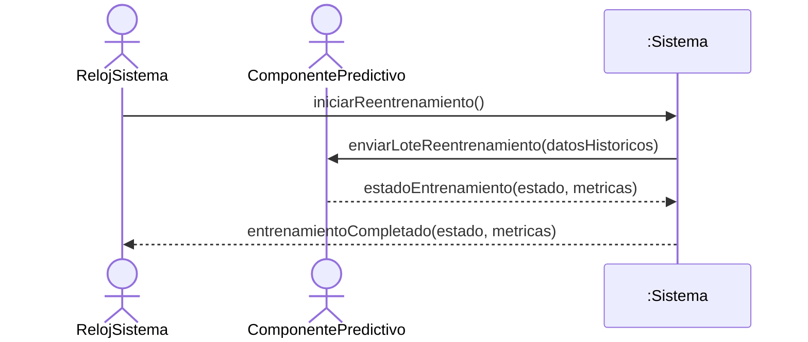
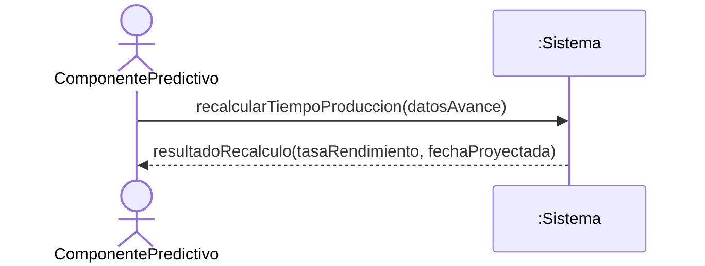
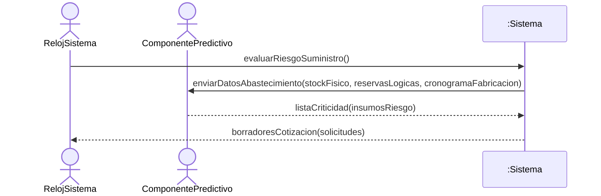
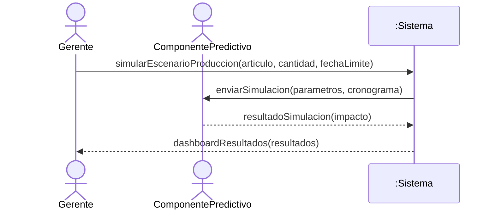
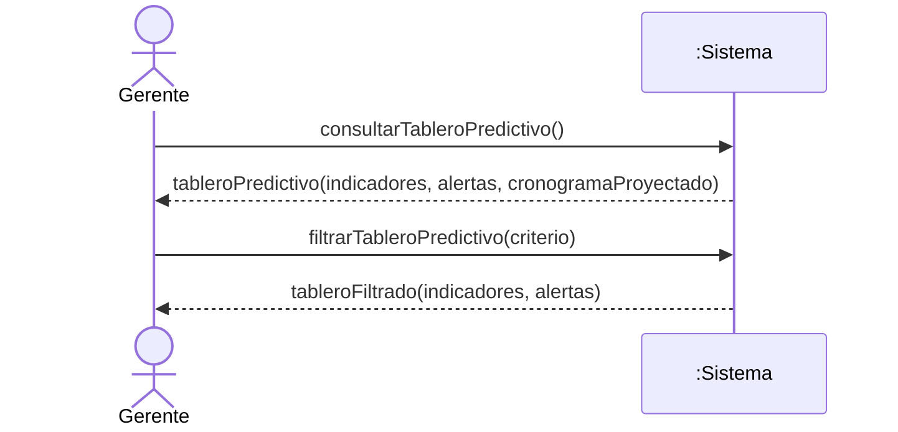

# Diagramas de Secuencia del Sistema (DSS) — Análisis Predictivo

> **Disciplina:** Análisis · Proceso Unificado
> **Fuente vinculante:** `docs/1-requisitos/casos-de-uso/analisis-predictivo.md`

## Criterio de modelado

- **Caja negra inviolable:** el sistema se representa como una única línea de vida `:Sistema`. No se exponen bases de datos, controladores, clases internas ni el modelo de Machine Learning como lifeline.
- **Actores del módulo (PascalCase):**
  - `Gerente` — actor humano (CU-PRED-04 y CU-PRED-05).
  - `RelojSistema` — actor de sistema externo, disparador temporizado (CU-PRED-01 y CU-PRED-03).
  - `ComponentePredictivo` — actor de sistema externo (CU-PRED-01, 02, 03 y 04). Se modela como actor externo, nunca como lifeline interna; la colaboración `:Sistema → ComponentePredictivo` es una interacción entre sistemas.
- **Orden de líneas de vida:** humanos primero, luego actores de sistema (`RelojSistema`, luego `ComponentePredictivo`), luego `:Sistema`.
- **Flujos automáticos:** CU-PRED-01, 02 y 03 son procesos automáticos disparados por el `RelojSistema` o reactivos a otro caso de uso; se indican con una nota sobre cada diagrama.
- **Eventos del sistema:** operaciones públicas con intención de negocio (camelCase), derivadas de la secuencia normal de cada caso de uso. No se modelan eventos de interfaz (`presionarBoton()`, `ingresarA()`, selección de pestañas) ni navegación. El procesamiento interno (compilar cronograma, consolidar lote, actualizar métricas) no se dibuja como mensaje.
- **Retornos:** solo se dibujan cuando aportan datos relevantes (estado del entrenamiento, proyección de tiempos, lista de criticidad, dashboard de resultados). En flujos de escritura se usa un retorno descriptivo.

## CU-PRED-01 — Ejecutar Reentrenamiento del Modelo

> **Flujo automático:** el disparador es el `RelojSistema`, que alcanza el intervalo de reentrenamiento programado (ej. domingo a las 02:00 AM) sin intervención humana. La colaboración `:Sistema → ComponentePredictivo` es una interacción entre sistemas: el componente predictivo es un actor externo (sistema secundario), por lo que la caja negra del monolito permanece intacta. El registro del evento en la auditoría (paso 5 del CU) es interno al sistema y no se modela como mensaje.

## CU-PRED-02 — Recalcular Tiempo de Producción

> **Flujo automático:** se dispara de forma reactiva al cierre de un Parte Diario en Producción (CU-PROD-13), sin intervención humana. El evento que entra al sistema proviene del `ComponentePredictivo` (actor reactivo), que comunica el avance de la Orden de Producción y solicita el recálculo; la caja negra del monolito permanece intacta. Si la fecha proyectada supera la fecha límite de la orden, el `:Sistema` genera internamente la Alerta de Cuello de Botella, que el Gerente visualiza luego en el tablero (CU-PRED-05).

## CU-PRED-03 — Evaluar Riesgo de Suministro

> **Flujo automático:** el disparador es el `RelojSistema`, que activa la evaluación periódica de inventario sin intervención humana. La colaboración `:Sistema → ComponentePredictivo` es una interacción entre sistemas; el componente predictivo es un actor externo, por lo que la caja negra del monolito permanece intacta. La generación de borradores de `SolicitudDeCotizacion` y la alerta del módulo de Compras (pasos 5 y 6 del CU) son efectos internos del `:Sistema` y no se modelan como mensajes.

## CU-PRED-04 — Simular escenario de producción

## CU-PRED-05 — Consultar Tablero Predictivo

