# Diagramas de Secuencia del Sistema (DSS) — Compras

> **Disciplina:** Análisis · Proceso Unificado
> **Fuente vinculante:** `docs/1-requisitos/casos-de-uso/compras.md`

## Criterio de modelado

- **Caja negra inviolable:** el sistema se representa como una única línea de vida `:Sistema`. No se exponen bases de datos, controladores, clases internas ni el motor predictivo como lifeline.
- **Actores del módulo (PascalCase):**
  - `EncargadoDeCompras` — actor humano principal.
  - `Proveedor` — actor humano externo (CU-COM-16 y CU-COM-17).
  - `MicroservicioPredictivo` — actor de sistema externo, secundario y no humano (CU-COM-20). Se modela como actor externo, nunca como lifeline interna.
- **Orden de líneas de vida:** humano(s) primero, luego el sistema externo, luego `:Sistema`.
- **Eventos del sistema:** operaciones públicas con intención de negocio (camelCase), derivadas de la secuencia normal de cada caso de uso. No se modelan eventos de interfaz (`presionarBoton()`, `clicEnEnviar()`) ni navegación.
- **Retornos:** solo se dibujan cuando aportan datos relevantes (listados, resultados, borrador predictivo, informe multicriterio, recomendación). En los flujos de escritura se usa un retorno descriptivo (`confirmacionAlta()`, `ordenConfirmada()`, etc.).
- **Datos internos como retornos:** el borrador predictivo (CU-COM-06), el informe multicriterio (CU-COM-11) y la recomendación (CU-COM-20) son RETORNOS del sistema, no eventos.

## CU-COM-01 — Alta de Proveedor

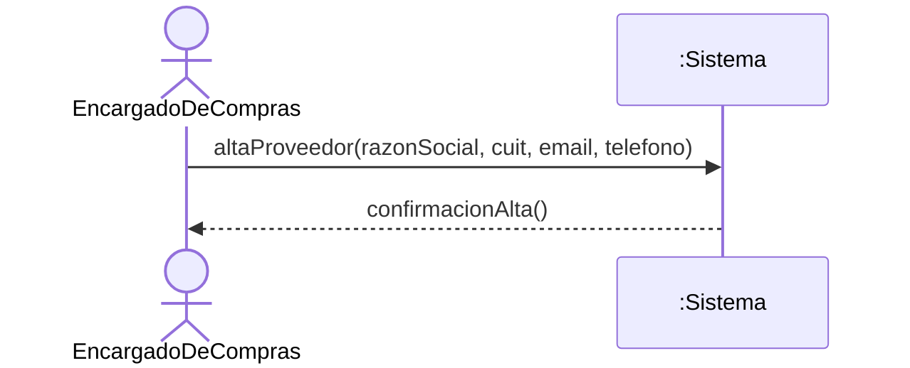

## CU-COM-02 — Baja de Proveedor

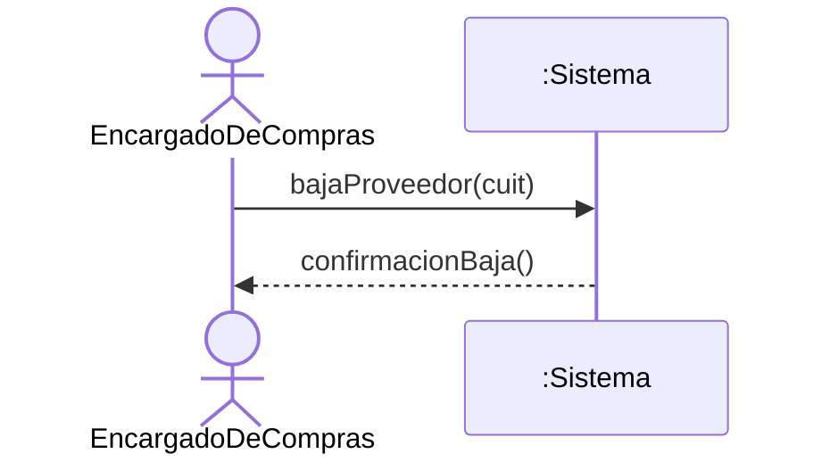

## CU-COM-03 — Modificación de Proveedor

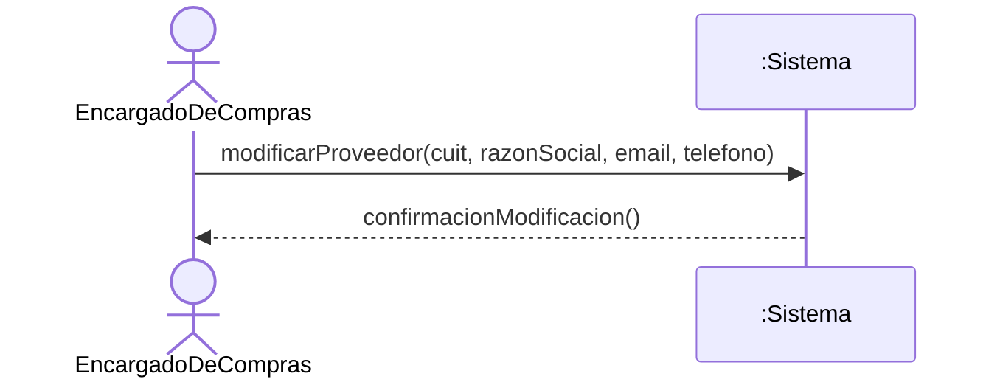

## CU-COM-04 — Listado de Proveedores

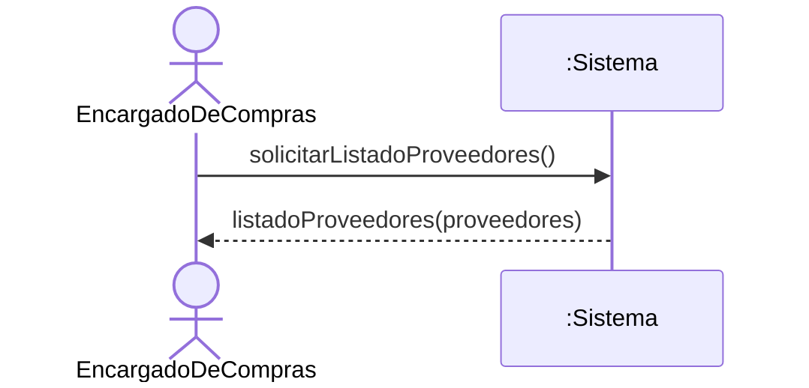

## CU-COM-05 — Buscar Proveedor

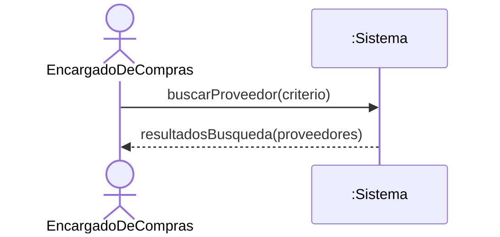

## CU-COM-06 — Alta de Solicitud de Cotización

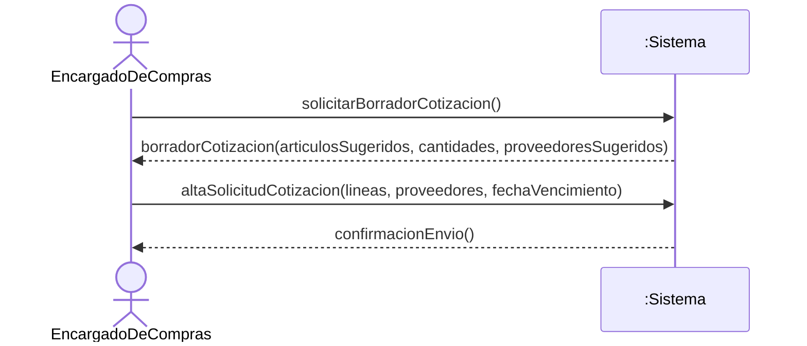

## CU-COM-07 — Baja de Solicitud de Cotización

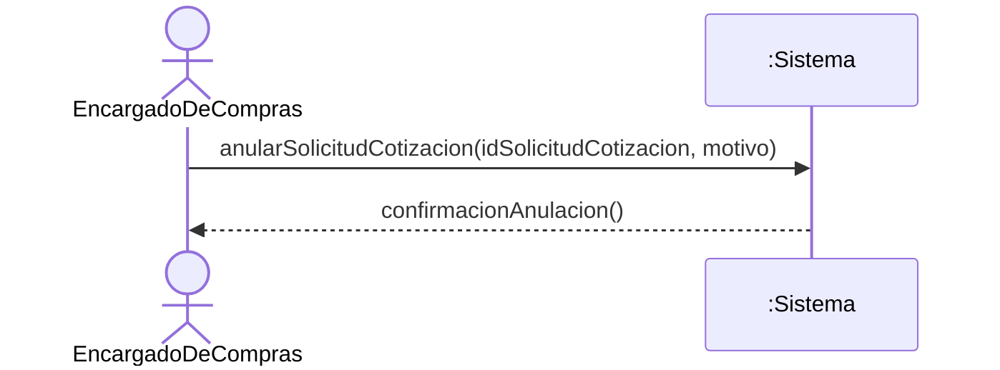

## CU-COM-08 — Modificación de Solicitud de Cotización

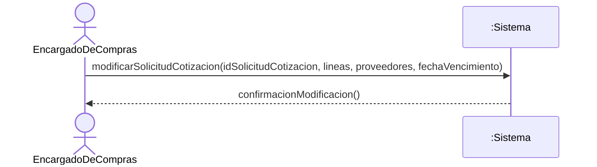

## CU-COM-09 — Listado de Solicitudes de Cotización

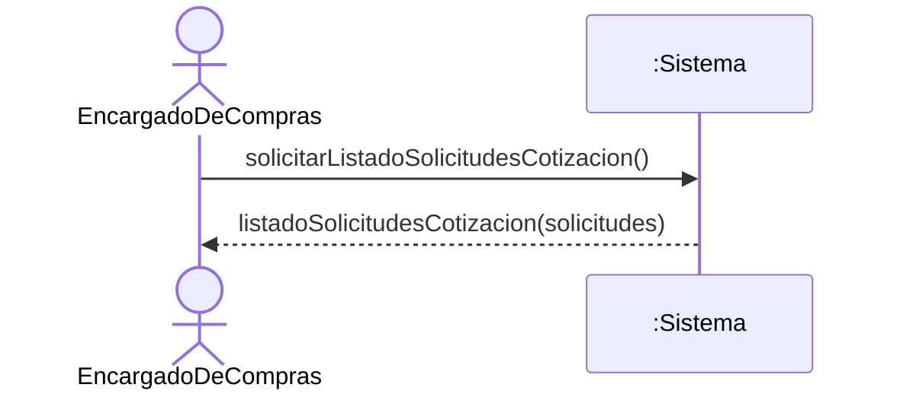

## CU-COM-10 — Buscar Solicitud de Cotización

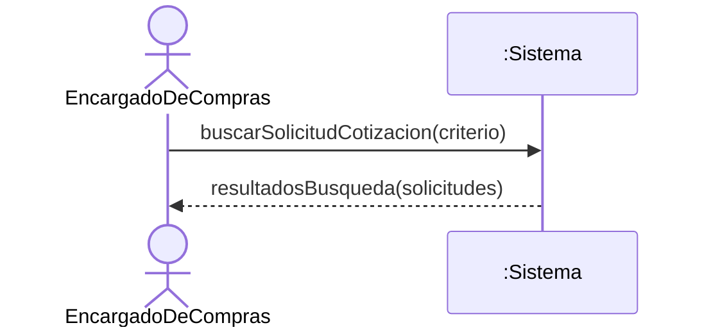

## CU-COM-11 — Alta de Orden de Compra

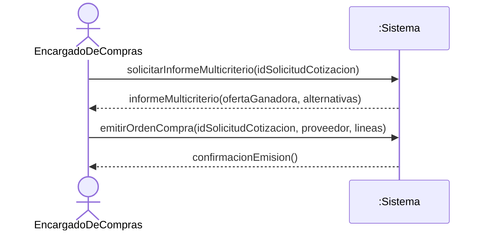

## CU-COM-12 — Baja de Orden de Compra

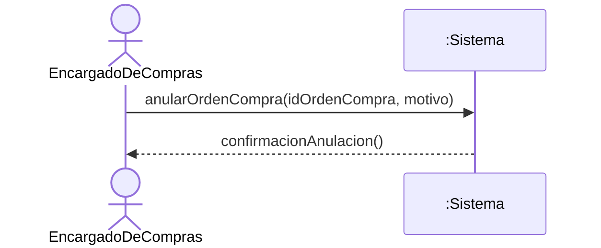

## CU-COM-13 — Modificación de Orden de Compra

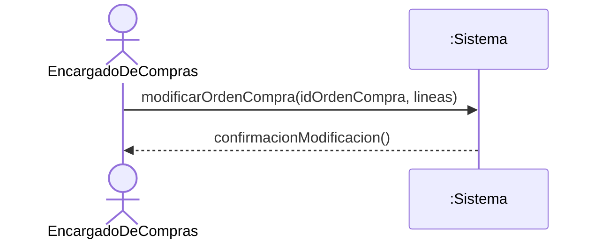

## CU-COM-14 — Listado de Órdenes de Compra

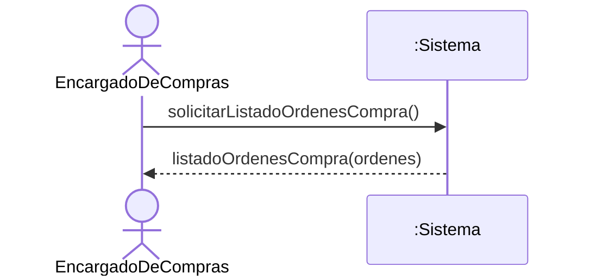

## CU-COM-15 — Buscar Orden de Compra

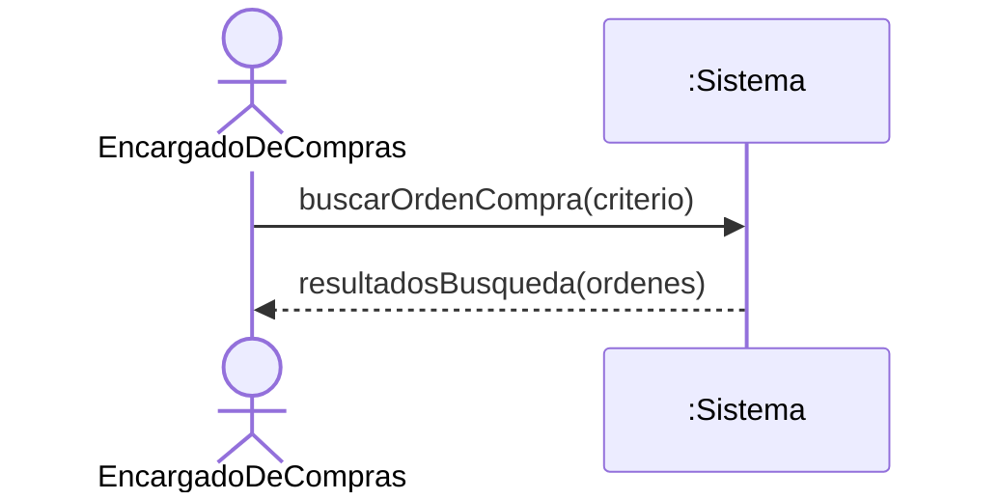

## CU-COM-16 — Enviar Cotización

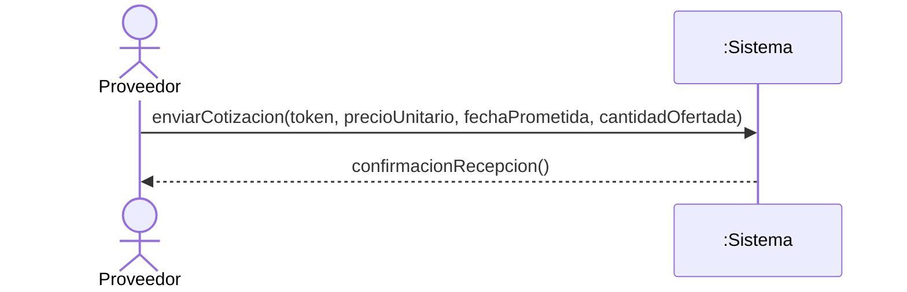

## CU-COM-17 — Confirmar Orden de Compra

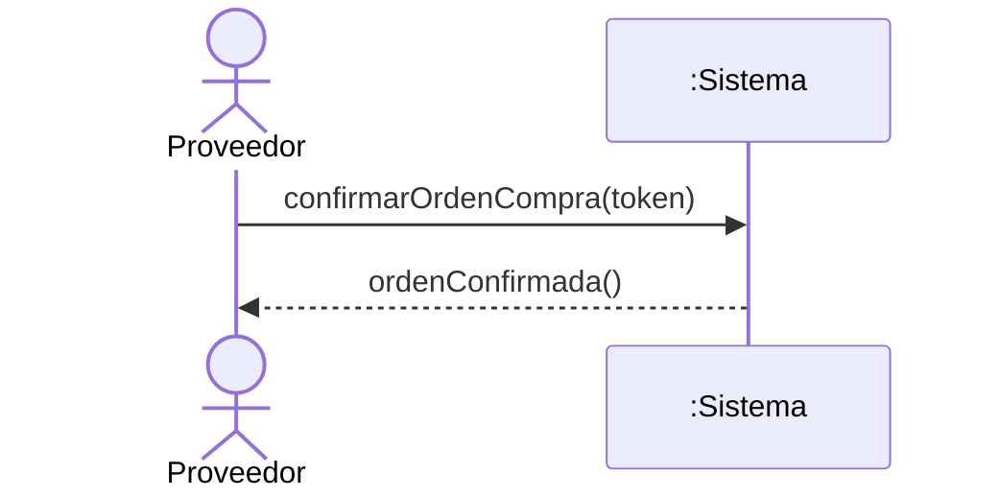

## CU-COM-18 — Consultar Ranking de Proveedores

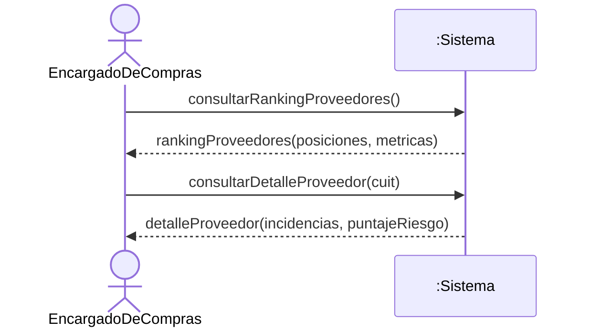

## CU-COM-19 — Solicitar Disponibilidad a Proveedor

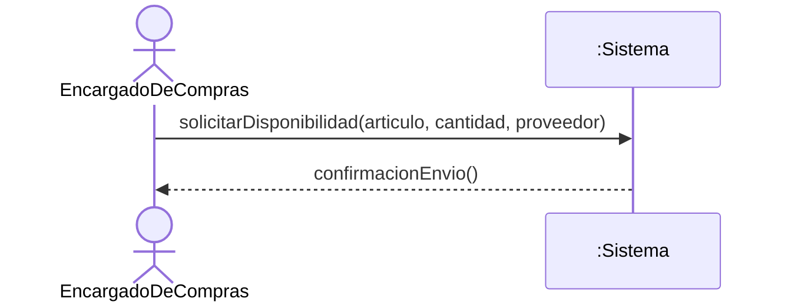

## CU-COM-20 — Resolver Disponibilidad de Compra

> **Flujo automático:** se dispara cuando el `Proveedor` carga su respuesta de disponibilidad (CU-COM-16). No hay intervención humana que lo inicie; el `EncargadoDeCompras` solo recibe la recomendación. La colaboración `:Sistema → MicroservicioPredictivo` es una interacción entre sistemas: el microservicio es un actor externo (sistema secundario), no una clase interna, por lo que la caja negra del monolito permanece intacta.

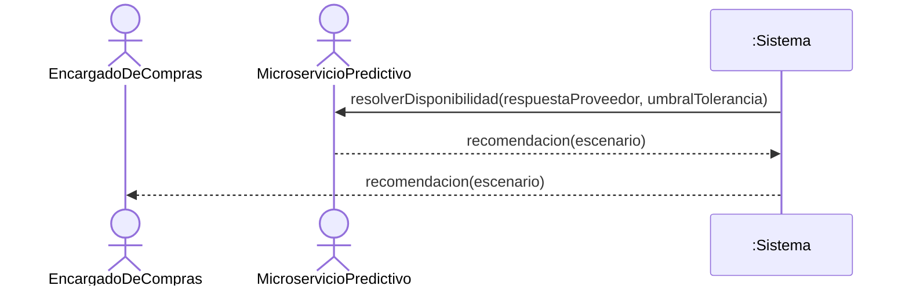
