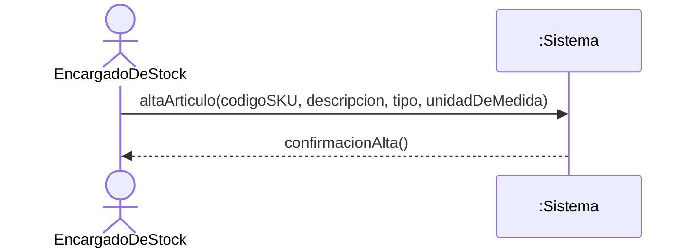
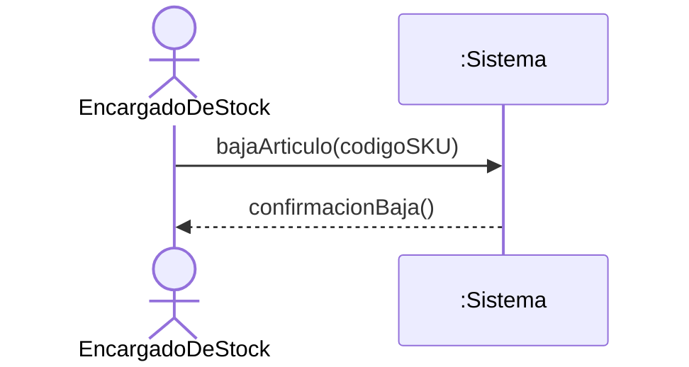
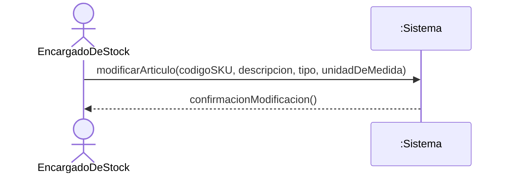
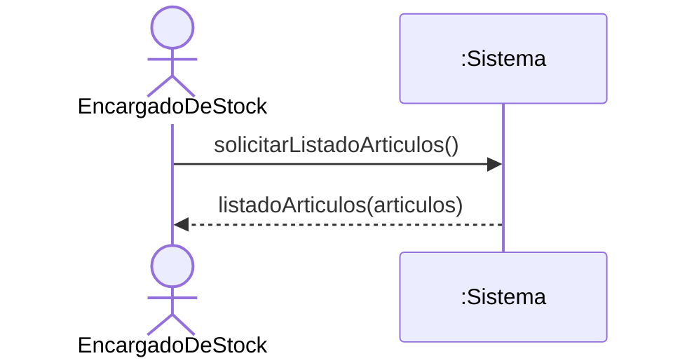
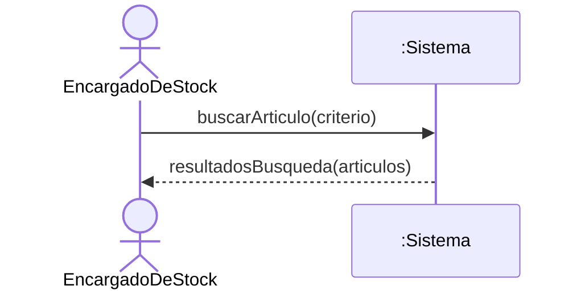
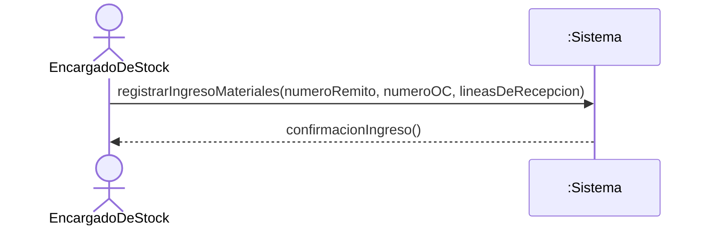

# Diagramas de Secuencia del Sistema (DSS) — Inventario

> **Disciplina:** Análisis · Proceso Unificado
> **Fuente vinculante:** `docs/1-requisitos/casos-de-uso/inventario.md`

## Criterio de modelado

- **Caja negra inviolable:** el sistema se representa como una única línea de vida `:Sistema`. No se exponen bases de datos, controladores, clases internas ni componentes.
- **Actor:** `EncargadoDeStock` (PascalCase), único actor del módulo.
- **Eventos del sistema:** operaciones públicas con intención de negocio (camelCase), derivadas de la secuencia normal de cada caso de uso. No se modelan eventos de interfaz (`presionarBotonGuardar()`, `clicEnCrear()`) ni navegación.
- **Retornos:** solo se dibujan cuando aportan datos relevantes (listados, resultados, datos de un artículo); en los flujos de escritura se usa un retorno descriptivo (`confirmacionAlta()`, etc.).

## CU-INV-01 — Alta de Artículo

## CU-INV-02 — Baja de Artículo

## CU-INV-03 — Modificación de Artículo

## CU-INV-04 — Listado de Artículos

## CU-INV-05 — Buscar Artículo

## CU-INV-06 — Registrar ingreso de materiales

## CU-INV-07 — Registrar Ajuste de Inventario

## CU-INV-08 — Parametrizar Umbrales de Stock

