# Diagramas de Secuencia del Sistema (DSS) — Mantenimiento

> **Disciplina:** Análisis · Proceso Unificado
> **Fuente vinculante:** `docs/1-requisitos/casos-de-uso/produccion.md` (sección "Subdominio Mantenimiento")

## Criterio de modelado

- **Caja negra inviolable:** el sistema se representa como una única línea de vida `:Sistema`. No se exponen bases de datos, controladores, clases internas ni componentes.
- **Actor único:** `SupervisorDeProduccion` (PascalCase), único actor del subdominio.
- **Eventos del sistema:** operaciones públicas con intención de negocio (camelCase), derivadas de la secuencia normal de cada caso de uso. No se modelan eventos de interfaz (`presionarBoton()`, `clicEnCrear()`) ni navegación.
- **Retornos:** solo se dibujan cuando aportan datos relevantes (listados, resultados de búsqueda); en los flujos de escritura se usa un retorno descriptivo (`confirmacionAlta()`, etc.).

## CU-MANT-01 — Alta de Maquinaria

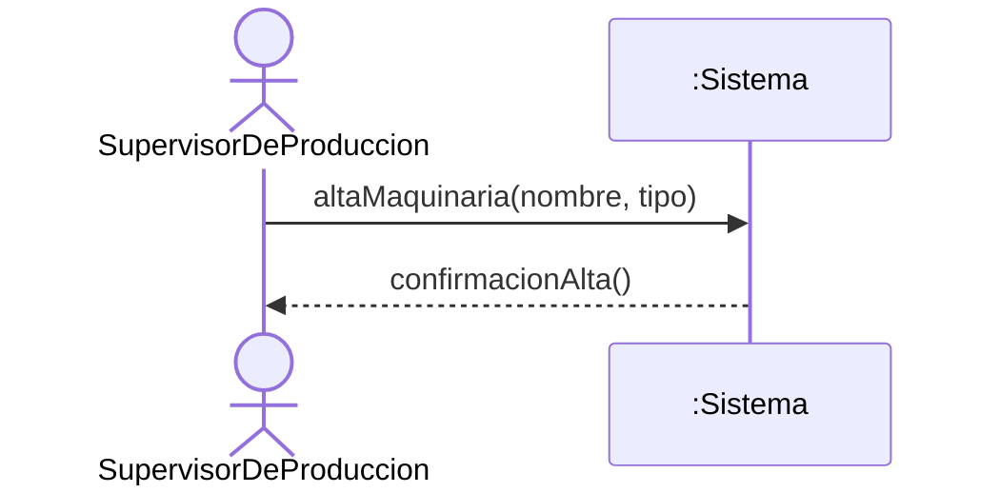

## CU-MANT-02 — Baja de Maquinaria

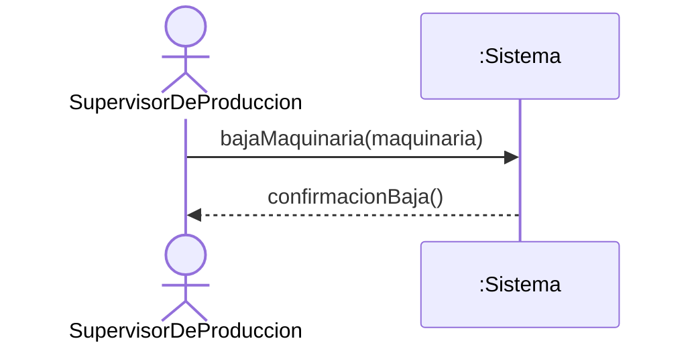

## CU-MANT-03 — Modificación de Maquinaria

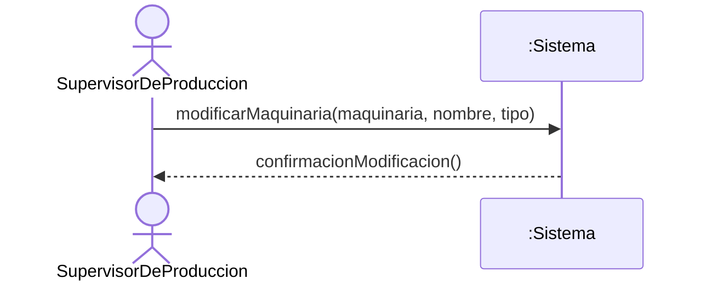

## CU-MANT-04 — Listado de Maquinarias

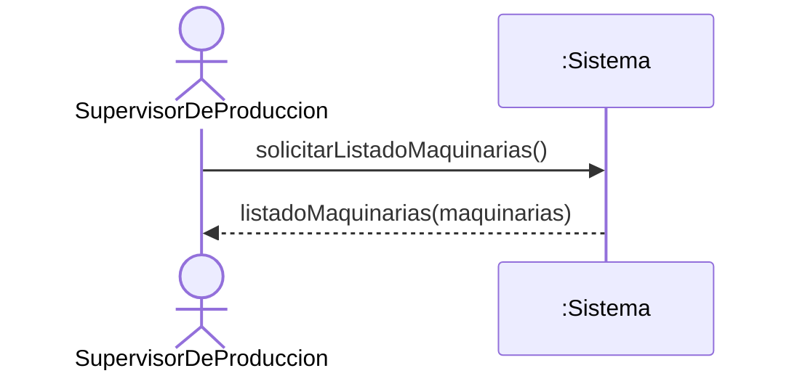

## CU-MANT-05 — Buscar Maquinaria

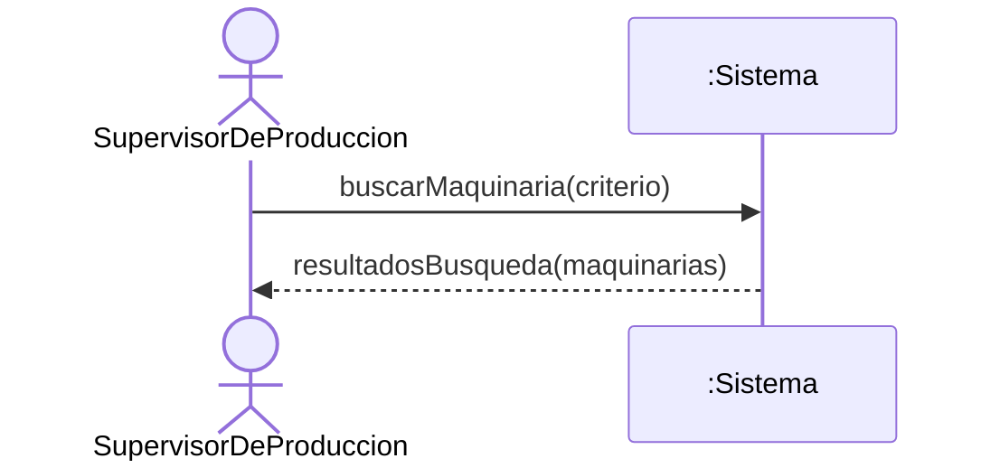

## CU-MANT-06 — Alta de Plan de Mantenimiento

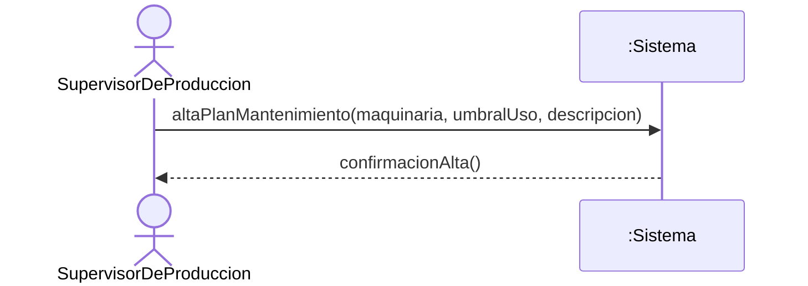

## CU-MANT-07 — Baja de Plan de Mantenimiento

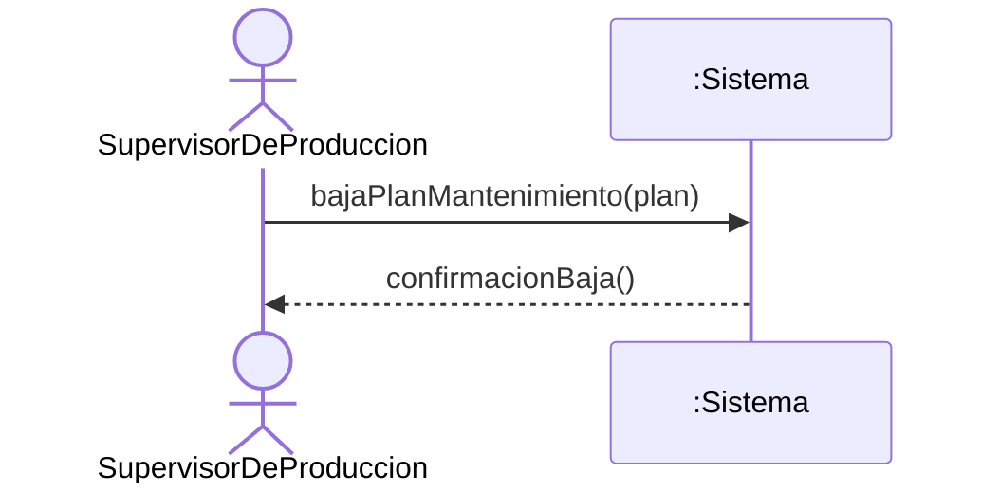

## CU-MANT-08 — Modificación de Plan de Mantenimiento

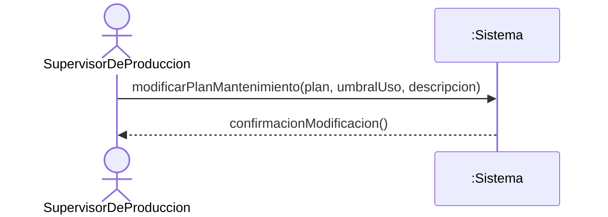

## CU-MANT-09 — Listado de Planes de Mantenimiento

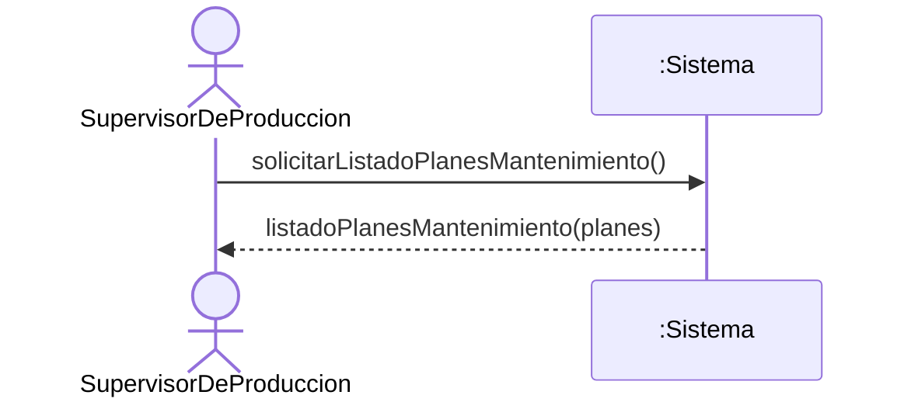

## CU-MANT-10 — Buscar Plan de Mantenimiento

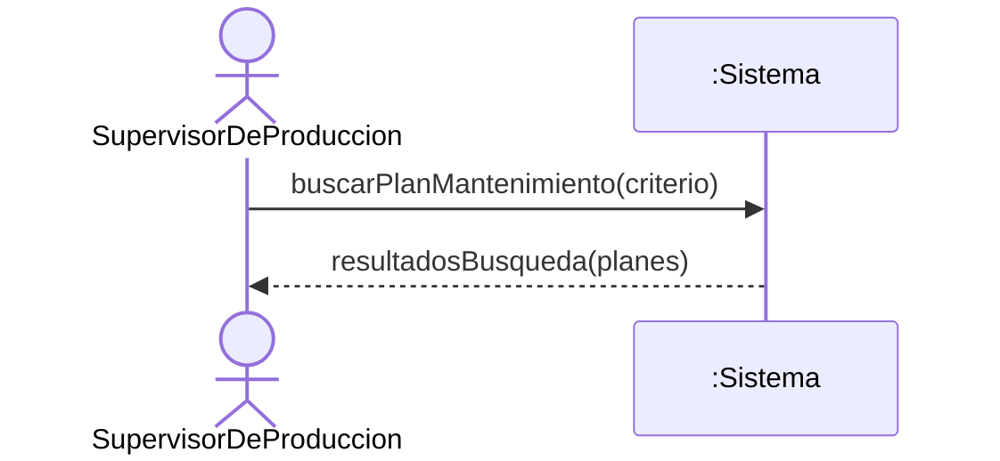

## CU-MANT-11 — Registrar Mantenimiento

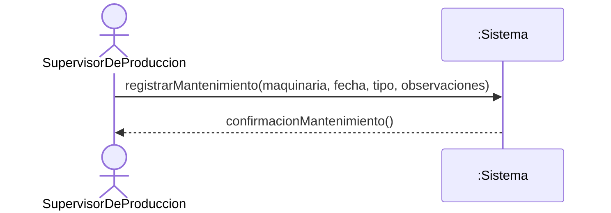
