# Diagramas de Secuencia del Sistema (DSS) — Producción

> **Disciplina:** Análisis · Proceso Unificado
> **Fuente vinculante:** `docs/1-requisitos/casos-de-uso/produccion.md`
> **Alcance:** CU-PROD-01 a CU-PROD-28 (módulo Producción core). Los CU-MANT-* se tratan en otro artefacto.

## Criterio de modelado

- **Caja negra inviolable:** el sistema se representa como una única línea de vida `:Sistema`. No se exponen bases de datos, controladores, clases internas ni el Microservicio Predictivo como línea de vida.
- **Actor:** `SupervisorDeProduccion` (PascalCase), único actor del módulo Producción core.
- **Eventos del sistema:** operaciones públicas con intención de negocio (camelCase), derivadas de la secuencia normal de cada caso de uso. No se modelan eventos de interfaz (`presionarBotonGuardar()`, `clicEnCrear()`) ni navegación.
- **Retornos:** solo se dibujan cuando aportan datos relevantes (listados, resultados de búsqueda); en los flujos de escritura se usa un retorno descriptivo (`confirmacionAlta()`, `confirmacionCierre()`).
- **Efectos asíncronos:** la petición asíncrona al Microservicio Predictivo (CU-PROD-13, paso 8) no es una interacción actor↔sistema en el mismo flujo; no se modela como actor ni como línea de vida. Queda documentada como postcondición/nota del contrato.

## CU-PROD-01 — Alta de Planificación de Producción

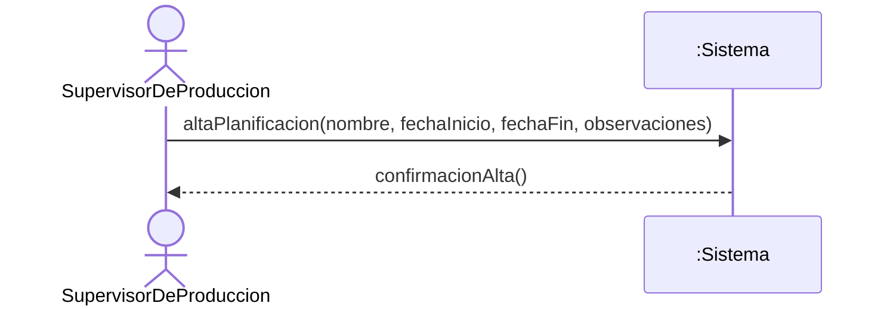

## CU-PROD-02 — Baja de Planificación de Producción

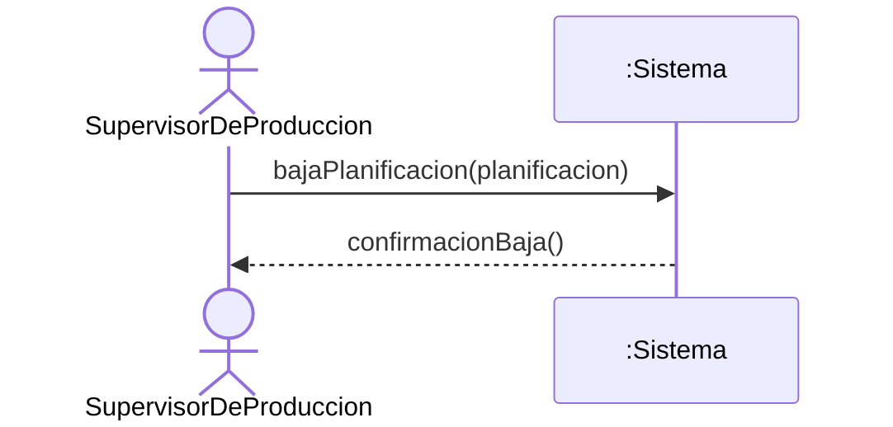

## CU-PROD-03 — Modificación de Planificación de Producción

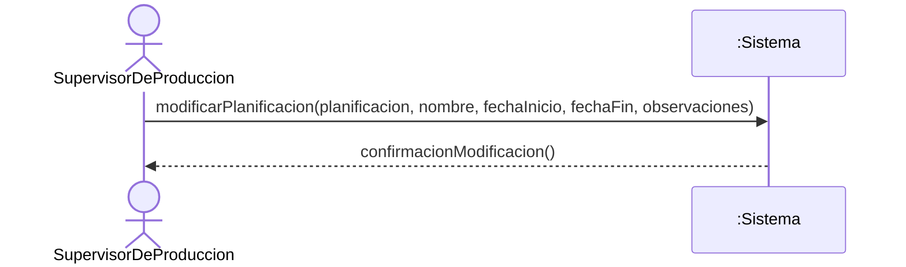

## CU-PROD-04 — Listado de Planificaciones de Producción

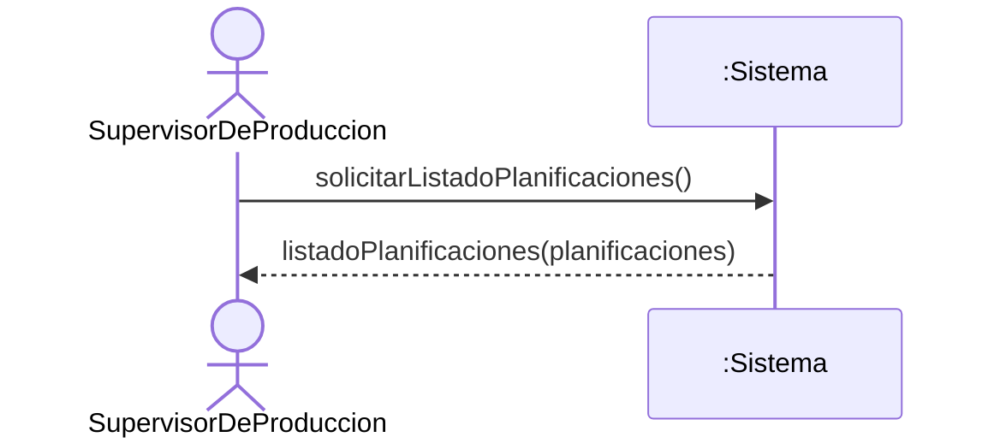

## CU-PROD-05 — Buscar Planificación de Producción

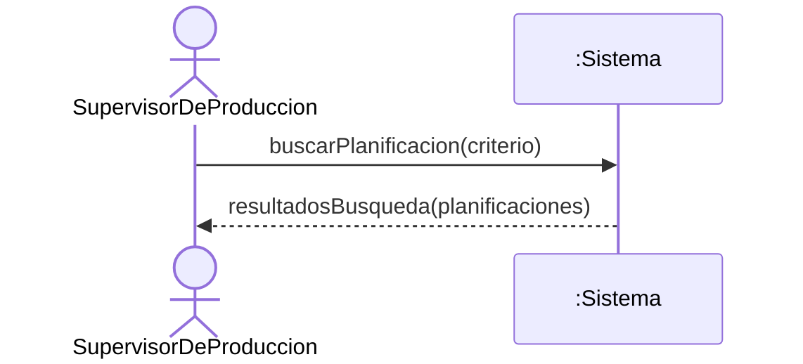

## CU-PROD-06 — Alta de Orden de Producción

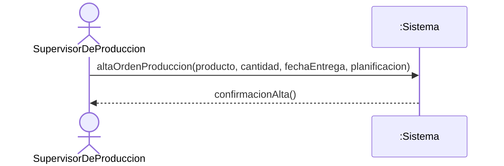

## CU-PROD-07 — Baja de Orden de Producción

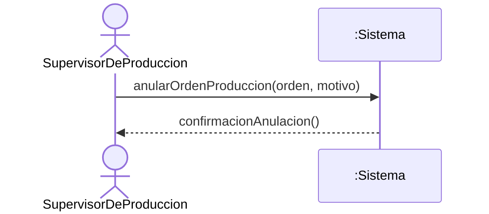

## CU-PROD-08 — Modificación de Orden de Producción

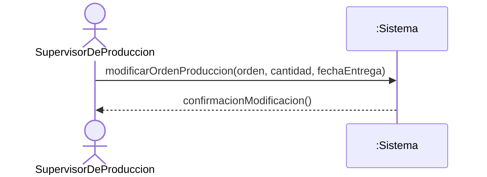

## CU-PROD-09 — Listado de Órdenes de Producción

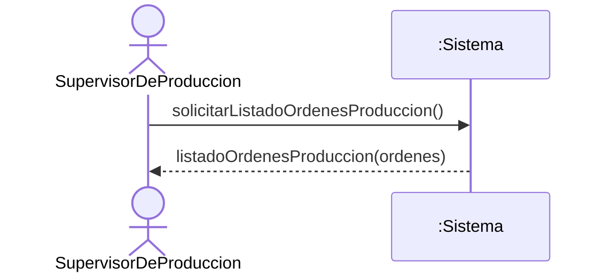

## CU-PROD-10 — Buscar Orden de Producción

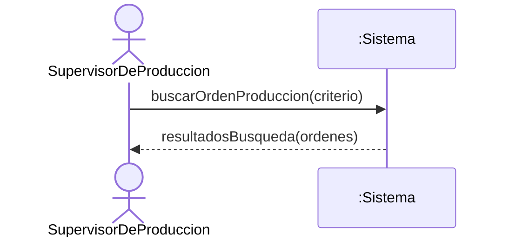

## CU-PROD-11 — Asignar Recursos a Orden

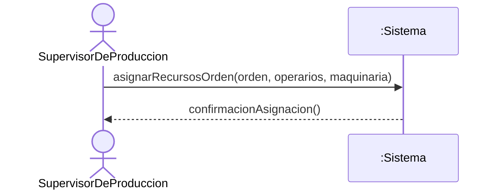

## CU-PROD-12 — Iniciar Orden de Producción


## CU-PROD-13 — Cargar Parte Diario

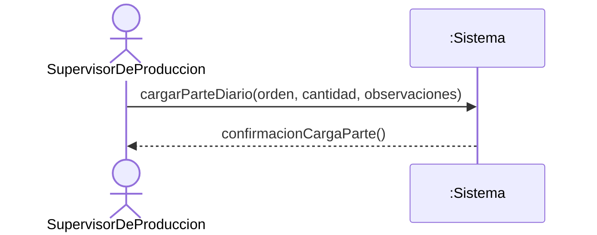

## CU-PROD-14 — Registrar Control de Calidad

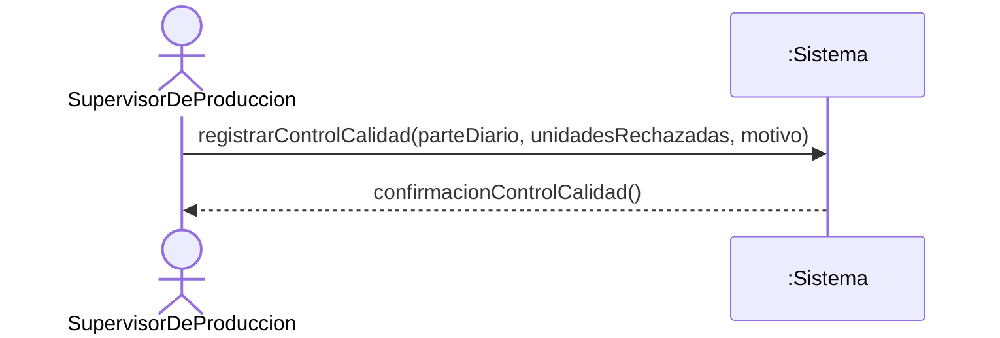

## CU-PROD-15 — Cerrar Orden de Producción


## CU-PROD-16 — Alta de Etapa de Producción

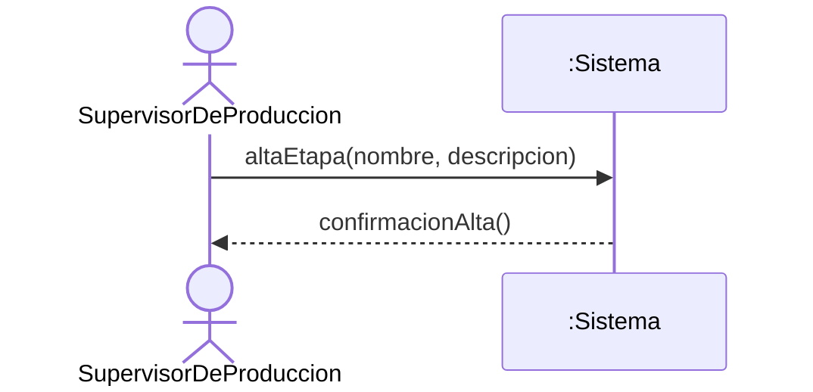

## CU-PROD-17 — Baja de Etapa de Producción

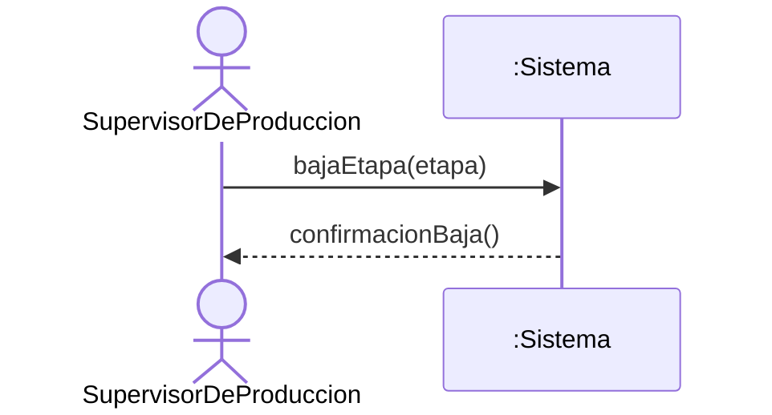

## CU-PROD-18 — Modificación de Etapa de Producción

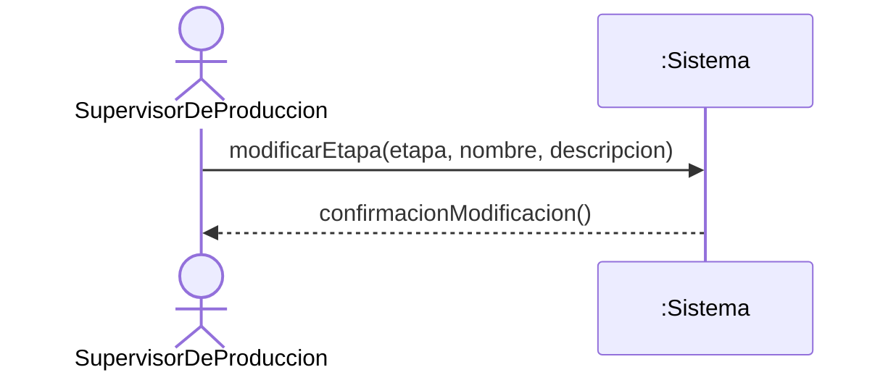

## CU-PROD-19 — Listado de Etapas de Producción

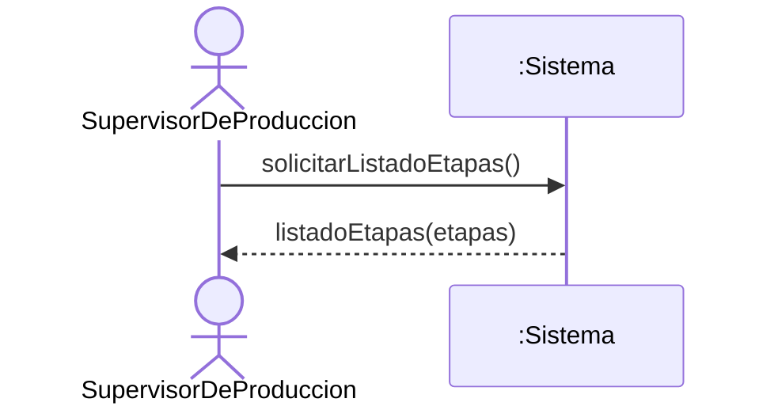

## CU-PROD-20 — Buscar Etapa de Producción

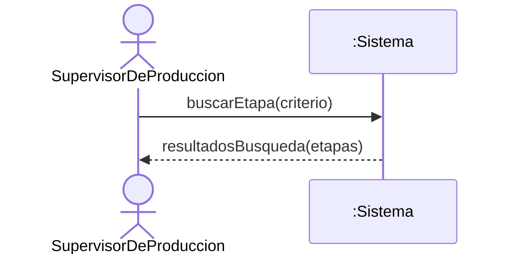

## CU-PROD-21 — Asignar Etapa a Producto

```mermaid
sequenceDiagram
    actor Supervisor as SupervisorDeProduccion
    participant Sistema as :Sistema
    Supervisor->>Sistema: asignarEtapaProducto(producto, etapa, tiempoPorUnidad)
    Sistema-->>Supervisor: confirmacionAsignacion()
```

## CU-PROD-22 — Desasignar Etapa de Producto

```mermaid
sequenceDiagram
    actor Supervisor as SupervisorDeProduccion
    participant Sistema as :Sistema
    Supervisor->>Sistema: desasignarEtapaProducto(producto, etapa)
    Sistema-->>Supervisor: confirmacionDesasignacion()
```

## CU-PROD-23 — Gestionar Cronograma de Producción

```mermaid
sequenceDiagram
    actor Supervisor as SupervisorDeProduccion
    participant Sistema as :Sistema
    Supervisor->>Sistema: gestionarCronograma(orden, nuevaPosicion)
    Sistema-->>Supervisor: confirmacionCronograma()
```

## CU-PROD-24 — Alta de Operario

```mermaid
sequenceDiagram
    actor Supervisor as SupervisorDeProduccion
    participant Sistema as :Sistema
    Supervisor->>Sistema: altaOperario(nombre, apellido, especialidad)
    Sistema-->>Supervisor: confirmacionAlta()
```

## CU-PROD-25 — Baja de Operario

```mermaid
sequenceDiagram
    actor Supervisor as SupervisorDeProduccion
    participant Sistema as :Sistema
    Supervisor->>Sistema: bajaOperario(operario)
    Sistema-->>Supervisor: confirmacionBaja()
```

## CU-PROD-26 — Modificación de Operario

```mermaid
sequenceDiagram
    actor Supervisor as SupervisorDeProduccion
    participant Sistema as :Sistema
    Supervisor->>Sistema: modificarOperario(operario, nombre, apellido, especialidad)
    Sistema-->>Supervisor: confirmacionModificacion()
```

## CU-PROD-27 — Listado de Operarios

```mermaid
sequenceDiagram
    actor Supervisor as SupervisorDeProduccion
    participant Sistema as :Sistema
    Supervisor->>Sistema: solicitarListadoOperarios()
    Sistema-->>Supervisor: listadoOperarios(operarios)
```

## CU-PROD-28 — Buscar Operario

```mermaid
sequenceDiagram
    actor Supervisor as SupervisorDeProduccion
    participant Sistema as :Sistema
    Supervisor->>Sistema: buscarOperario(criterio)
    Sistema-->>Supervisor: resultadosBusqueda(operarios)
```
