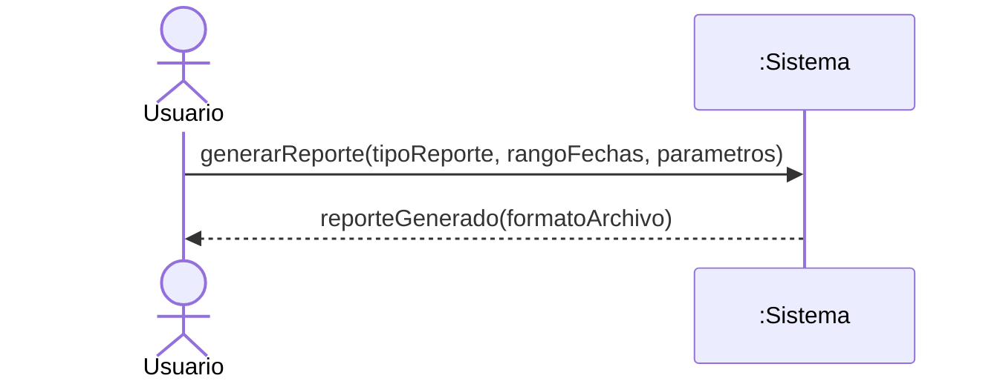
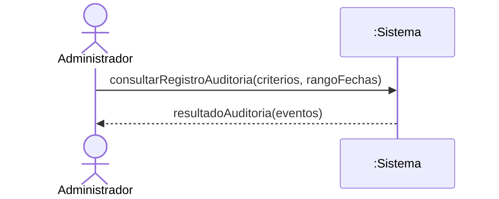

# Diagramas de Secuencia del Sistema (DSS) — Reportes y Auditoría

> **Disciplina:** Análisis · Proceso Unificado
> **Fuente vinculante:** `docs/1-requisitos/casos-de-uso/reportes.md` (CU-REP-01), `docs/1-requisitos/casos-de-uso/auditoria.md` (CU-AUD-01)

## Criterio de modelado

- **Caja negra inviolable:** el sistema se representa como una única línea de vida `:Sistema`. No se exponen bases de datos, controladores, clases internas ni componentes como lifeline.
- **Actores del módulo (PascalCase):**
  - `Usuario` — actor humano genérico (CU-REP-01): representa a "los distintos actores" del sistema, cada uno con permisos sobre el área del reporte que solicita.
  - `Administrador` — actor humano principal (CU-AUD-01). El caso de uso también lo ejecuta `Gerente`; se modela con `Administrador` como representante de ambos roles con permiso de auditoría.
- **Eventos del sistema:** operaciones públicas con intención de negocio (camelCase), derivadas de la secuencia normal de cada caso de uso. No se modelan eventos de interfaz (`presionarGenerar()`, `clicEnBuscar()`) ni navegación ("ingresar al generador", "acceder al log").
- **Retornos:** en estas consultas el retorno ES el dato relevante: el reporte exportable (CU-REP-01) y los eventos de auditoría resultantes (CU-AUD-01). No se modela la presentación en pantalla —"ver con opción de descargar"— como evento separado.
- **Sin contratos de operación:** consultas puras sin reglas de negocio que cambien el estado del dominio (Larman: no se redactan contratos para consultas triviales; ver `docs/2-analisis/contratos/_plantilla-contrato.md`).

## CU-REP-01 — Generar Reportes

## CU-AUD-01 — Consultar Registro de Auditoría

> **Nota:** el caso de uso aplica a los roles `Administrador` y `Gerente`, siempre que tengan permiso de auditoría. Se modela con `Administrador` como actor representante.

