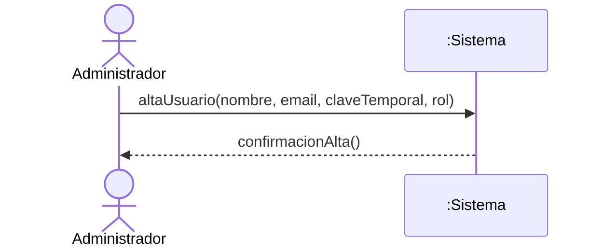
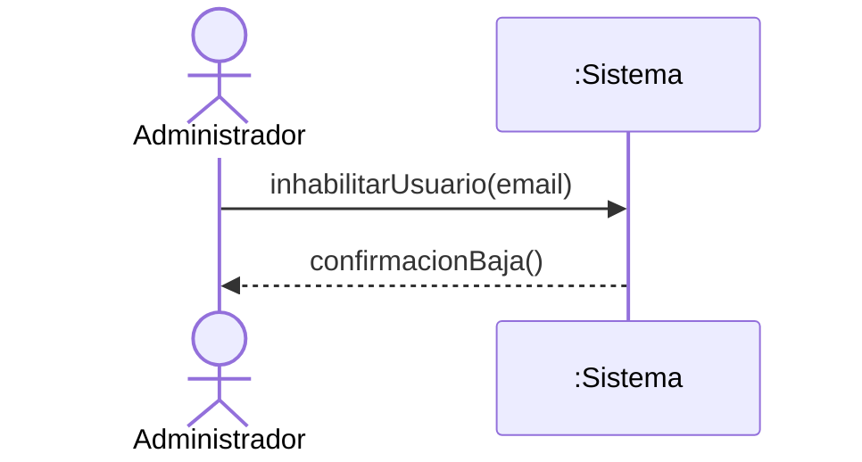
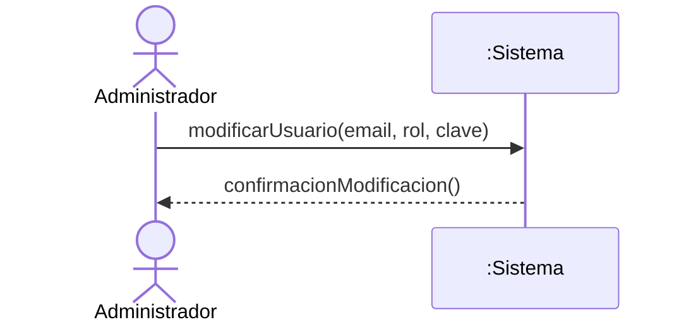
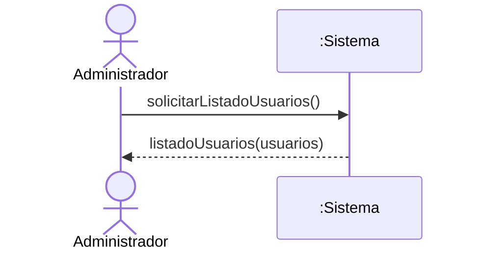
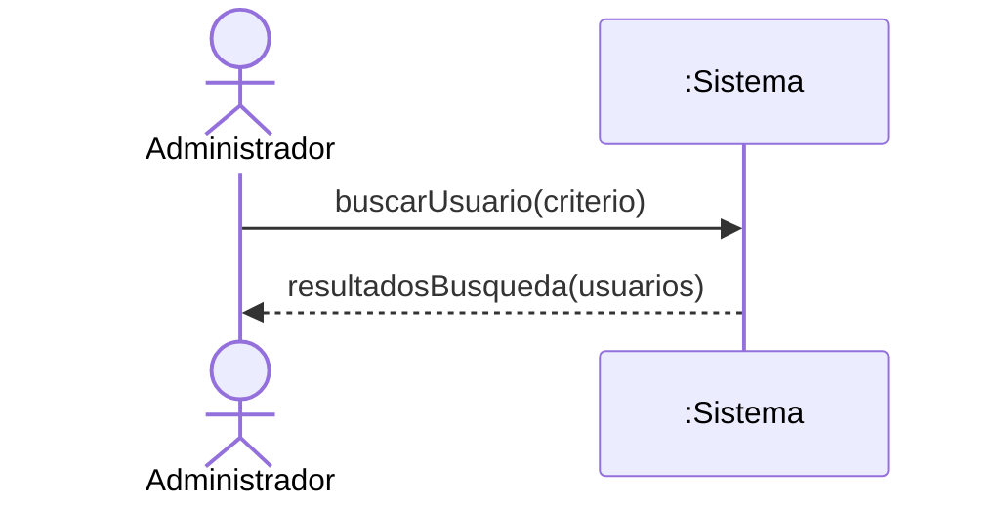
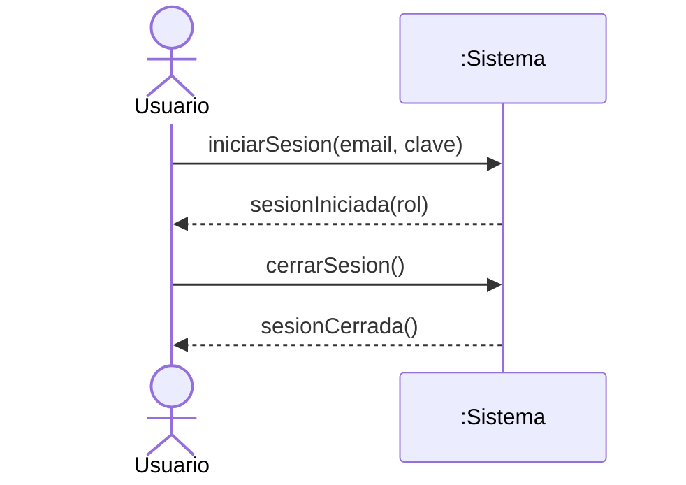
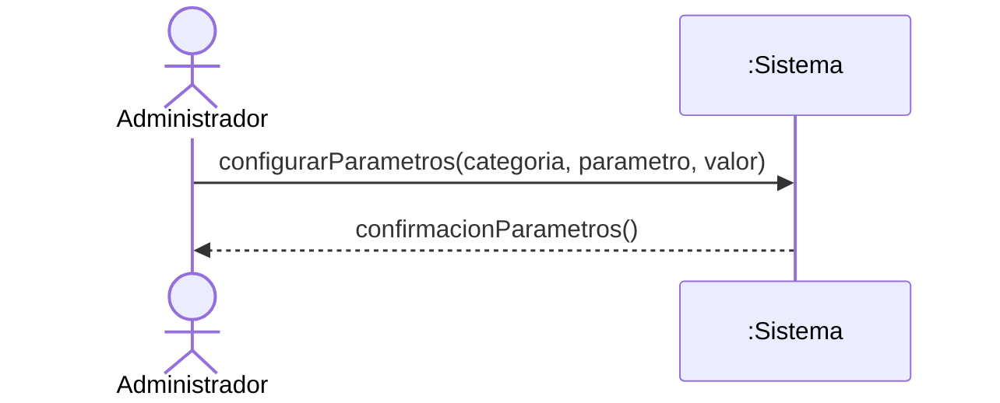

# Diagramas de Secuencia del Sistema (DSS) — Usuarios y Seguridad

> **Disciplina:** Análisis · Proceso Unificado
> **Fuente vinculante:** `docs/1-requisitos/casos-de-uso/usuarios-seguridad.md`

## Criterio de modelado

- **Caja negra inviolable:** el sistema se representa como una única línea de vida `:Sistema`. No se exponen bases de datos, controladores, clases internas ni mecanismos de sesión como lifeline.
- **Actores del módulo (PascalCase):**
  - `Administrador` — actor humano principal (CU-USR-01 a 05 y 07).
  - `Usuario` — actor humano genérico, cualquier usuario del sistema (CU-USR-06, Iniciar/Cerrar Sesión).
- **Eventos del sistema:** operaciones públicas con intención de negocio (camelCase), derivadas de la secuencia normal de cada caso de uso. No se modelan eventos de interfaz (`presionarBoton()`, `clicEnGuardar()`) ni navegación ("acceder al gestor", "ingresar a la vista").
- **Retornos:** solo se dibujan cuando aportan datos relevantes (listados, resultados, rol cargado en la sesión). En los flujos de escritura se usa un retorno descriptivo (`confirmacionAlta()`, `confirmacionBaja()`, etc.).

## CU-USR-01 — Alta de Usuario

## CU-USR-02 — Baja de Usuario

## CU-USR-03 — Modificación de Usuario

## CU-USR-04 — Listado de Usuarios

## CU-USR-05 — Buscar Usuario

## CU-USR-06 — Iniciar/Cerrar Sesión

## CU-USR-07 — Configurar Parámetros del Sistema

