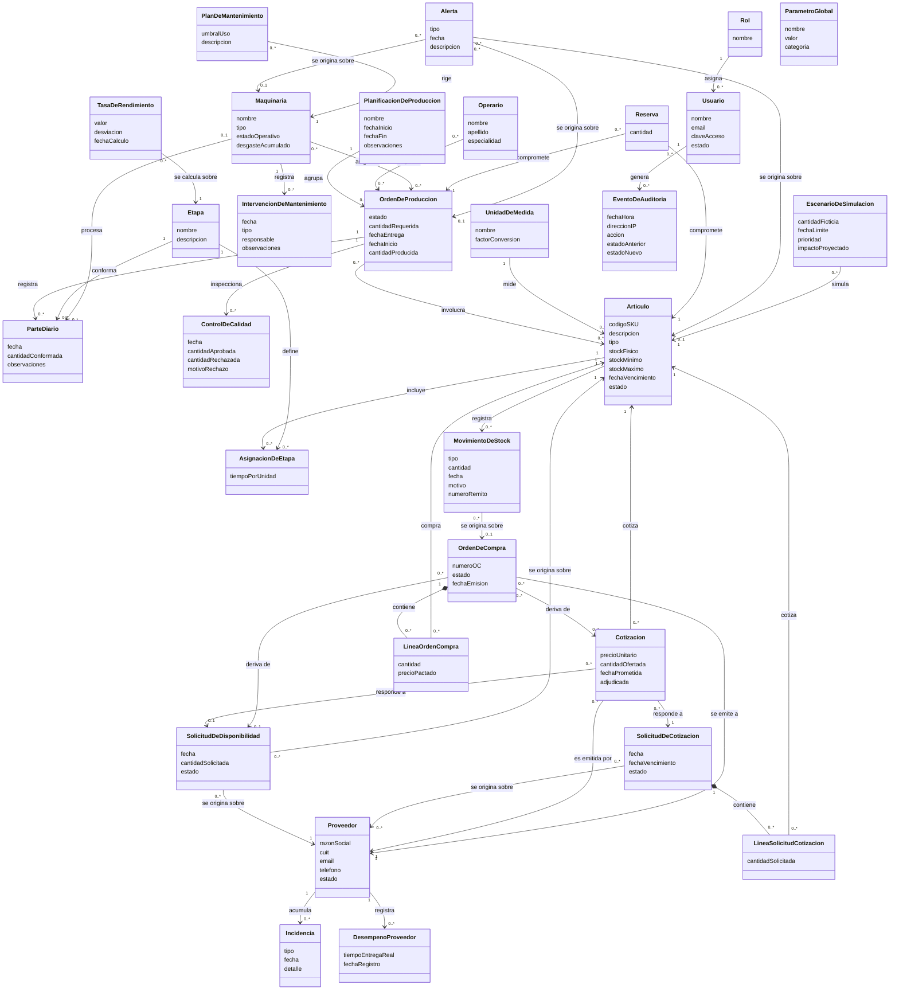

# Modelo de Dominio — Diagrama Mermaid (30 conceptos)

> **Disciplina:** Análisis · Proceso Unificado
> **Fuente:** `01-conceptos.md`, `02-descripciones.md`, `03-relaciones.md`, `04-atributos.md`
> **Nota de uso:** Renderizar con https://mermaid.live o bloque Mermaid en Obsidian (plugin mermaid).

## Leyenda

- **Clases:** rectángulo con dos compartimentos (Nombre PascalCase + atributos camelCase). Sin métodos, sin visibilidad, sin claves foráneas.
- **Composición (rombo relleno `*--`):** solo para las líneas de detalle con ciclo de vida acoplado a su cabecera — `LineaSolicitudCotizacion` (parte de `SolicitudDeCotizacion`) y `LineaOrdenCompra` (parte de `OrdenDeCompra`). La línea muere con su cabecera.
- **Asociación simple (`-->`):** el resto de los vínculos. Sin agregación (rombo blanco) en ningún caso.
- **Clases de asociación** (`AsignacionDeEtapa`, `LineaSolicitudCotizacion`, `LineaOrdenCompra`, `DesempenoProveedor`): se dibujan como clases normales con sus atributos, conectadas a ambos extremos que vinculan (no como rombo).
- **Multiplicidades derivadas de `03-relaciones.md`** (propuesta de lectura del modelador, no cambios al dominio):
  - *"A es un registro de B"* → B `1`, A `0..*`.
  - *"A se emite/origina sobre B"* → B `1` (o `0..1` cuando el origen es opcional, ej. `Cotizacion`→`SolicitudDeDisponibilidad`, `OrdenDeCompra`→`Cotizacion`), A `0..*`.
  - *"A se calcula/emite sobre B"* → B `1` (o `0..1` para los destinos opcionales de `Alerta`), A `0..*`.
  - *"A se vincula a B"* → el lado "catálogo" (`Etapa`, `Articulo`, `UnidadDeMedida`, `Maquinaria`) `1`, el lado transaccional `0..*`.
  - *"A es asignado a B"* → N:M (`0..*`/`0..*`) para `Operario` y `Maquinaria`; `Rol`→`Usuario` se lee como un rol `1` que cubre `0..*` usuarios.
- **`ParametroGlobal`** es un concepto autónomo (sin relaciones), como indica la nota 1 de `03-relaciones.md`.
