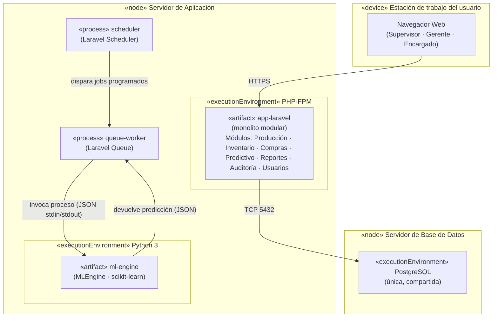

# Diagrama de Despliegue — SIGPAP

> **Disciplina:** Diseño · Proceso Unificado
> **Fuente vinculante:** CAM-001 (`8-Gestion-de-Cambios/CAM-001-arquitectura-ml.md`), `contratos-entre-modulos.md`
> **Nota de uso:** Renderizar con https://mermaid.live o bloque Mermaid en Obsidian (plugin mermaid).

## Leyenda

### Nodos

- **`«device» Estación de trabajo`** — dispositivo físico del usuario (navegador). Los actores interactúan vía web: Supervisor (Parte Diario), Gerente (tableros/simulador), Encargado de Compras (licitaciones).
- **`«node» Servidor de Aplicación`** — aloja el monolito Laravel y el proceso Python de ML. Un único servidor; no hay despliegue distribuido.
- **`«node» Servidor de Base de Datos`** — PostgreSQL **única y compartida**. Ningún otro componente escribe en ella.

### Componentes internos del servidor de aplicación

| Componente | Rol |
| --- | --- |
| `app-laravel` (PHP-FPM) | Monolito modular. Dueño del estado y de la base de datos. Contiene los 7 módulos y la abstracción `MLEngine`. |
| `queue-worker` | Proceso Laravel Queue. Ejecuta los jobs asíncronos (reentrenamiento, recálculo de TRR, evaluación de riesgo). |
| `scheduler` | Proceso Laravel Scheduler. Dispara los jobs programados (reentrenamiento semanal, evaluación periódica de inventario). |
| `ml-engine` (Python) | Componente especializado de ML. **Calcula y devuelve; no persiste.** |

### Decisiones de despliegue registradas

1. **Monolito modular, no microservicios.** Un único proceso Laravel. FastAPI **no** aparece en el despliegue actual: queda documentado como evolución futura si el componente ML escala.
2. **Una sola PostgreSQL.** Ni el componente ML ni ningún otro servicio escribe en la base por su cuenta. Solo `app-laravel` accede a PostgreSQL.
3. **El ML es un proceso, no un servicio HTTP.** Laravel invoca el `ml-engine` vía **stdin/stdout (JSON)** desde el `queue-worker`, detrás de la abstracción `MLEngine`. No hay endpoints HTTP, ni Guzzle, ni SQLAlchemy, ni health checks distribuidos.
4. **Dirección de los datos.** `app-laravel` → `ml-engine` envía datos; `ml-engine` → `app-laravel` devuelve predicciones. El `ml-engine` jamás modifica tablas transaccionales: el módulo dueño aplica el resultado.
5. **Procesos asíncronos aislados.** `queue-worker` y `scheduler` son procesos separados de PHP-FPM para no bloquear la petición del usuario.

## Evolución futura (no en el alcance actual)

Si en el futuro el componente ML requiriera escalar independientemente (más predicciones simultáneas, GPU, otro equipo a cargo del ML), el `ml-engine` se convertiría en un servicio FastAPI detrás de la **misma** abstracción `MLEngine`. Ese cambio es de despliegue (un nodo más), no de arquitectura: los módulos seguirían hablando con `MLEngine` sin enterarse.
